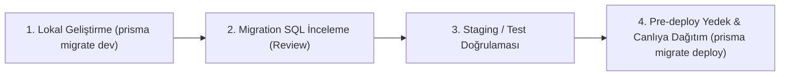

# Pusena: Canlı Veritabanı Dağıtımı, Yedekleme ve Rollback Kılavuzu (Database Runbook)

Bu doküman, **Pusena** projesinin canlı veritabanı (PostgreSQL / Supabase / Render) mimarisi, Prisma ORM migration süreçleri, şema doğrulama, otomatik yedekleme ve olası felaket anında veri kaybı yaşamaksızın geri alma (rollback) prosedürlerini adım adım tanımlar.

---

## 1. Veritabanı Mimarisi ve Bağlantı Yapısı

### 1.1. Altyapı ve Havuzlama (Connection Pooling)
- **Veritabanı Motoru:** PostgreSQL 15+ (Supabase Managed Cloud Postgres).
- **Bağlantı Türleri:**
  1. **Direct Connection (Doğrudan Bağlantı - Port 5432):**
     - Sadece Prisma CLI migration işlemleri (`prisma migrate deploy`) ve veritabanı şema güncellemeleri için kullanılır.
     - URL Formatı: `postgresql://postgres:[PASSWORD]@[HOST]:5432/[DB_NAME]?sslmode=require`
  2. **Transaction Pooler / PgBouncer (Havuzlanmış Bağlantı - Port 6543):**
     - Canlı API sunucusu (NestJS runtime) tarafından kullanılır.
     - Çoklu serverless / container bağlantı açma isteklerini yönetir ve PostgreSQL `max_connections` sınırının aşılmasını engeller.
     - URL Formatı: `postgresql://postgres.[REF]:[PASSWORD]@[POOL_HOST]:6543/[DB_NAME]?pgbouncer=true&connection_limit=10&pool_timeout=20`

---

## 2. Dağıtım Kuralları ve Güvenlik İlkeleri (Golden Rules)

> [!CAUTION]
> **Kritik Kural:** Canlı (Production) ortamda **ASLA** `npx prisma db push` ÇALIŞTIRILMAZ!
> `prisma db push`, var olan migration geçmişini atlar; veri kaybı yaratabilecek sütun/tablo silme işlemlerini sessizce uygulayabilir ve şema uyumsuzluğuna (schema drift) yol açar.

### 2.1. Standart Şema Değişiklik Yaşam Döngüsü
Tüm veritabanı değişiklikleri aşağıdaki 4 aşamalı hiyerarşiyi takip etmek zorundadır:



1. **Lokal Geliştirme:**
   - Geliştirici `prisma/schema.prisma` dosyasını düzenler.
   - `npx prisma migrate dev --name <aciklayici_isim>` komutuyla yerel migration dosyası (`prisma/migrations/<timestamp>_<aciklayici_isim>/migration.sql`) üretilir.
2. **SQL İncelemesi (Review):**
   - Üretilen SQL dosyasında yıkıcı ifadeler (`DROP TABLE`, `DROP COLUMN`, `ALTER COLUMN ... NOT NULL` varsayılan değersiz) var mı denetlenir.
3. **Staging / CI Doğrulaması:**
   - CI pipeline'ında migration sentaksı ve uygulanabilirliği test edilir.
4. **Canlıya Dağıtım (Deploy):**
   - Canlı veritabanı anlık yedeği (snapshot) alınır.
   - `npx prisma migrate deploy` komutu çalıştırılarak yalnızca henüz uygulanmamış migration dosyaları çalıştırılır.

---

### 2.2. Sıfır Kesinti (Zero-Downtime) İçin "Expand and Contract" Modeli

Canlıda kullanıcılar uygulamayı aktif kullanırken veri kaybı ve API hatalarını önlemek için iki aşamalı şema evrimi uygulanır:

| Aşama | Yapılacak İşlem | Örnek Senaryo (Sütun Yeniden Adlandırma) |
| :--- | :--- | :--- |
| **Faz 1: Genişlet (Expand)** | Yeni sütun nullable veya default değer ile eklenir. Eski sütun silinmez. Kod her iki sütunu da destekler veya yeni sütuna yazar. | `avatarUrl` yerine `avatarMediaId` eklenecekse, `avatarMediaId` nullable olarak açılır; kod yeni yüklenenleri buraya yazar. |
| **Faz 2: Göç Ettir (Migrate)** | Arka plan job'ı ile eski sütundaki veriler yeni sütuna aktarılır. | Eski `avatarUrl` kayıtları `avatarMediaId` formatına dönüştürülür. |
| **Faz 3: Daralt (Contract)** | Tüm mobil ve web istemcileri yeni sürüme güncellendikten sonra eski sütun güvenle kaldırılır. | Eski `avatarUrl` sütununu kaldıran migration çalıştırılır. |

---

## 3. Dağıtım Öncesi Doğrulama ve Durum Kontrolleri

Canlı veritabanına herhangi bir kod veya migration göndermeden önce çalıştırılması gereken kontrol komutları:

### 3.1. Şema Sentaks ve Model Doğrulaması
```bash
# Prisma şemasının geçerliliğini ve ilişkilerini doğrular
npx prisma validate
```

### 3.2. Migration Durumu ve Drift Tespiti
```bash
# Canlı veritabanı ile migration klasörü arasındaki uyumu sorgular
npx prisma migrate status
```
- **Beklenen Çıktı:** `Database schema is up to date.` veya uygulanmayı bekleyen bekleyen migration listesi.
- **Uyarı Çıktısı (Drift):** `Following migration have failed...` veya `Database schema has drifted.` görülürse **KESİNLİKLE** dağıtım durdurulur ve manuel SQL incelemesi yapılır.

---

## 4. Yedekleme ve Anlık Görüntü (Backup Strategy)

### 4.1. Otomatik Günlük Yedekler
- Supabase yönetim panelinde otomatik günlük yedekleme ve WAL (Write-Ahead Logging) tabanlı 7 günlük Point-In-Time Recovery (PITR) aktif tutulur.

### 4.2. Dağıtım Öncesi Manuel Anlık Yedek (On-Demand Snapshot)
Her majör sürüm veya veritabanı migration'ı öncesinde API sunucusu veya CI/CD üzerinden tam mantıksal yedek alınır:

```bash
# Zaman damgalı PostgreSQL dump alma komutu
TIMESTAMP=$(date +%Y%m%d_%H%M%S)
pg_dump -Fc --no-owner --no-acl \
  -h db.your-supabase-project.supabase.co \
  -p 5432 \
  -U postgres \
  -d postgres \
  -f "pusena_backup_${TIMESTAMP}.dump"
```

### 4.3. Yedeğin Güvenli Saklanması ve Şifreleme
- Üretilen `.dump` dosyası yerel sunucuda bırakılmaz; AES-256 şifrelemeli AWS S3 veya Google Cloud Storage (GCS) `backup-vault` bucket'ına aktarılır:
```bash
aws s3 cp "pusena_backup_${TIMESTAMP}.dump" "s3://pusena-db-backups/prod/" --sse aws:kms
```

---

## 5. Acil Durum ve Geri Alma Prosedürü (Rollback Runbook)

Bir migration başarısız olduğunda veya canlı ortamda beklenmeyen veri bozulması/uygulama çökmesi tespit edildiğinde uygulanacak eylem planı:

### 5.1. Durum Tespiti ve Trafik Yönetimi (T+0 dk)
1. Render / API ortamında son dağıtılan release'i bir önceki stabil sürüme geri çekin (Rollback deploy).
2. Gerekirse bakım modunu etkinleştirin veya kritik uç noktaları geçici olarak devre dışı bırakın.

### 5.2. Senaryo A: Geriye Dönük Uyumlu Migration (Hafif Hata)
Eğer yapılan migration yalnızca yeni sütun/tablo eklediyse ve mevcut verilere zarar vermediyse:
- Eski backend sürümü yeni sütunları zaten görmezden geldiği için sadece backend rollback'i yeterlidir.
- Veritabanı üzerinde aceleyle `DROP COLUMN` çalıştırılmaz; planlı bir sonraki migration beklenir.

### 5.3. Senaryo B: Veri Bozulması veya Başarısız Migration (Kritik Hata)
Eğer migration yarıda kaldıysa veya veri bütünlüğü bozulduysa:

1. **Migration Kaydını Çözümleme:**
   ```bash
   # Başarısız olarak işaretlenmiş migration kaydını düzeltmek için
   npx prisma migrate resolve --rolled-back "<migration_folder_name>"
   ```
2. **Yedekten Geri Yükleme (Restore from Dump):**
   ```bash
   # Veritabanını dağıtım öncesi snapshot'a temiz geri yükleme
   pg_restore --clean --if-exists --no-owner --no-acl \
     -h db.your-supabase-project.supabase.co \
     -p 5432 \
     -U postgres \
     -d postgres \
     "pusena_backup_<TIMESTAMP>.dump"
   ```
3. **Supabase Point-in-Time Recovery (PITR):**
   - Supabase Dashboard -> Project Settings -> Database -> Backups sekmesine gidin.
   - Dağıtımın başladığı dakikadan 2 dakika öncesini seçerek "Restore to point in time" işlemini başlatın.

---

## 6. Dağıtım Sonrası Doğrulama ve Sağlık Kontrolleri (Smoke Tests)

Geri yükleme veya canlı dağıtım tamamlandığında aşağıdaki kontroller sırasıyla çalıştırılır:

1. **Sağlık Endpoint'i Kontrolü:**
   ```bash
   curl -i https://pusena-api.onrender.com/api/health
   # Beklenen yanıt: HTTP 200 OK {"status":"ok","database":"connected"}
   ```
2. **Kritik Tabloların Bütünlük Sayımı:**
   ```sql
   SELECT 'users' as tbl, count(*) FROM "User"
   UNION ALL
   SELECT 'pregnancies', count(*) FROM "Pregnancy"
   UNION ALL
   SELECT 'period_cycles', count(*) FROM "PeriodCycle"
   UNION ALL
   SELECT 'relationships', count(*) FROM "Relationship";
   ```
3. **İncelemeci Test Hesaplarının Giriş Doğrulaması:**
   - `reviewer.female@pusena.com` ile token alma ve profil getirme testi.
   - `reviewer.male@pusena.com` ile partner senkronizasyon testi.
