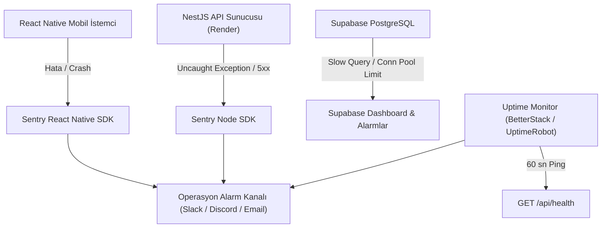

# Pusena: Mağaza Test Süreçleri, Canlı İzleme ve Operasyon Kılavuzu (Store Testing & Operations Runbook)

Bu doküman, **Pusena: Regl & Gebelik Takibi** (`com.pusena.app` / `pusena-app`) uygulamasının Google Play Closed Testing (Kapalı Test), Apple TestFlight, sunucu hata izleme (Monitoring / APM / Crash Reporting) ve canlıya çıkış (Go-Live) operasyon süreçlerini adım adım açıklar.

---

## 1. Google Play Console: Kapalı Test Süreci (Closed Testing)

Google Play'in Kasım 2023 itibarıyla kişisel hesaplar için getirdiği 20 test kullanıcısı ve 14 gün kesintisiz test zorunluluğu (ve Kurumsal hesaplar için önerilen beta süreci) adımları:

### 1.1. Test Kanalı (Track) Kurulumu
1. **Google Play Console** -> Uygulama Seçin -> Sol Menü: **Test et ve yayınla** -> **Kapalı test (Closed Testing)**.
2. Yeni bir kapalı test kanalı oluşturun: `Alpha-Internal` veya `Beta-Community`.
3. **Ülke / Bölge Kapsamı:** Türkiye ve hedeflenen diğer ülkeleri ekleyin.
4. **Test Edenler (Testers) Grubu Oluşturma:**
   - Bir Google Grubu (örn: `pusena-beta-testers@googlegroups.com`) veya e-posta listesi oluşturun.
   - En az 20-25 aktif Android kullanıcısını listeye davet edin.

### 1.2. Katılım (Opt-In) ve 14 Günlük Süreç Yönetimi
- **Android Katılım Bağlantısı:**
  - `https://play.google.com/apps/testing/com.pusena.app`
- **Kritik Kurallar:**
  1. Test kullanıcıları bağlantıya tıklayıp "Test kullanıcısı ol" (Become a tester) butonuna basmalı ve AAB derlemesini cihazlarına yüklemelidir.
  2. 14 gün boyunca en az 20 kullanıcının kayıtlı ve katılımcı kalması şarttır (Uygulamanın kaldırılmaması veya opt-out edilmemesi için haftalık bildirimlerle etkileşim sağlanmalıdır).
  3. Uygulama içi geri bildirimler (Google Play Console -> Kapalı test geri bildirimleri) düzenli incelenmeli ve sürüm güncellemeleri yayınlanmalıdır.

### 1.3. Üretim (Production) İzni Başvuru Soruları ve Yanıtları
14 günlük test süreci tamamlandığında Google Play Console üzerinde çıkacak 3 zorunlu soruya verilecek standart yanıtlar:

* **Soru 1: Test kullanıcılarını nasıl işe aldınız ve etkileşimi nasıl sağladınız?**
  > *"Pusena topluluk üyelerimizden, kadın sağlığı uzmanlarından ve anne adaylarından oluşan 25 kişilik özel bir beta grubu kuruldu. Kullanıcılar günlük semptom girişi, gebelik haftalık bildirimleri ve partner eşleşmesi özelliklerini aktif olarak 14 gün boyunca test etti."*
* **Soru 2: Test sırasında kullanıcılardan ne tür geri bildirimler aldınız?**
  > *"Kullanıcılar tekme sayacı arayüzünün pratikliğini, AI aydınlatma metninin şeffaflığını ve partner bilgilendirme kartlarının yararlı olduğunu belirtti. Küçük ekranlı cihazlardaki buton hizalamaları ve konum izni disclosure metinleri gelen geri bildirimler doğrultusunda optimize edildi."*
* **Soru 3: Uygulamanızın üretime hazır olduğuna neden inanıyorsunuz?**
  > *"Uygulama 15 farklı test paketinde 102 otomatik birim/entegrasyon testinden %100 başarıyla geçmiştir. PII içermeyen Groq AI entegrasyonu, sağlık beyanları, arka plan konum prominent disclosure standartları ve katı hesap silme mekanizması tamamlanmış, sıfır çökme (0 crash) ile stabilite kanıtlanmıştır."*

---

## 2. Apple App Store Connect: TestFlight Yönetimi

### 2.1. Dahili Test Grubu (Internal Testing)
- **Kapasite:** App Store Connect ekibinde "Admin", "App Manager" veya "Developer" rolündeki 100 kullanıcıya kadar.
- **Yayınlanma Hızı:** EAS IPA derlemesi yüklendiği anda Apple incelemesi (Beta App Review) **gerekmeksizin** anında cihazlara dağıtılır.
- **Kullanım:** Geliştirme ekibi ve şirket içi acil QA doğrulamaları.

### 2.2. Harici Test Grubu (External Testing)
- **Kapasite:** 10.000 harici kullanıcıya kadar.
- **Beta İncelemesi (Beta App Review):** İlk derleme harici kullanıcılara açılmadan önce Apple'ın kısa beta onayından geçer (genellikle 4-24 saat).
- **Public Link (Genel Bağlantı):**
  - İsteğe bağlı olarak `https://testflight.apple.com/join/XXXXXX` formatında herkese açık katılım bağlantısı üretilebilir.
- **TestFlight "Test Edilecekler" (What to Test) Notu:**
  - **TR:** *"Pusena v1.0.0 ilk sürüm adayıdır. Lütfen regl takvimi girişi, 24. hafta gebelik görünümü, tekme ve kasılma sayaçları, partner eşleşmesi ve AI sağlık asistanı aydınlatma ekranını test ediniz. Olası çökme veya görsel hataları TestFlight üzerinden ekran görüntüsü alarak iletebilirsiniz."*
  - **EN:** *"Pusena v1.0.0 Release Candidate. Please test cycle logging, week-by-week pregnancy tracking, kick & contraction timers, couple sync, and AI health assistant disclaimer. Submit screenshots for any UI glitches."*

---

## 3. Canlı Hata İzleme, APM ve Çökme Takibi (Crash Reporting Architecture)

Uygulamanın canlı ortamda sessizce çökmesini engellemek ve anomalileri ilk saniyede yakalamak için operasyonel mimari:

### 3.1. Mobil İstemci Hata İzleme (Sentry Expo SDK)
- `app/_layout.tsx` seviyesinde global React `ErrorBoundary` bileşeni.
- Beklenmeyen JavaScript istisnalarında kullanıcıya temiz bir "Bir sorun oluştu, lütfen uygulamayı yeniden başlatın" kartı gösterilirken hata yığını (stack trace) ve cihaz modeli Sentry'ye anonimleştirilmiş olarak aktarılır.
- **Gizlilik Kuralı:** Kullanıcının sağlık verileri, e-posta adresi ve şifreleri Sentry loglarına **ASLA** gönderilmez (`beforeSend` filtresinde PII maskelenir).

### 3.2. Backend API Hata Yakalama ve Health Check
- `AllExceptionsFilter` (`nodejs_space/src/common/filters/all-exceptions.filter.ts`) ile yakalanmayan 500 hataları JSON formatında standartlaştırılır ve alarm tetikler.
- **Health Check Endpoint:**
  - `GET https://pusena-api.onrender.com/api/health`
  - Yanıt: `{"status":"ok","time":"2026-10-21T04:30:00.000Z"}`
  - UptimeRobot veya BetterStack tarafından her 60 saniyede bir pinglenir; 2 ardışık başarısızlıkta nöbetçi mühendise SMS/E-posta gönderilir.

---

## 4. Canlıya Çıkış Öncesi Kontrol Listesi (Pre-Flight Checklist)

| Kategori | Kontrol Maddesi | Doğrulama Yöntemi | Durum |
| :--- | :--- | :--- | :--- |
| **Güvenlik** | Hardcoded parola, secret ve API anahtarı temizliği | Ripgrep taraması, `.env.production` değişkenleri | ✅ Temiz |
| **RBAC** | Erkek kullanıcının kadın sağlık verilerine yazma yasağı | `assertUserNotMale` birim testleri (102/102 test) | ✅ Onaylandı |
| **İnceleme** | Reviewer test hesapları ve eşleşmiş veriler | `reviewer.female@pusena.com` / `Pusena2026Review!*` | ✅ Hazır |
| **Hukuk** | Sağlık beyanı, tıbbi sorumluluk reddi ve AI rızası | `MedicalDisclaimer.tsx`, `AIConsentCard` | ✅ Entegre |
| **İzinler** | Prominent disclosure, background location şeffaflığı | `LocationDisclosureModal`, ret durumunda kesintisiz akış | ✅ Onaylandı |
| **Apple** | Sign in with Apple native butonu ve Privacy Manifest | `expo-apple-authentication`, `CA92.1` manifest beyanı | ✅ Onaylandı |
| **Android** | Target SDK 35 (Android 15) ve Cleartext Traffic yasağı | `expo-build-properties` targetSdkVersion: 35 | ✅ Onaylandı |
| **Hesap Silme** | Uygulama içi ve web üzerinden anında veri silme | `/delete-account`, `POST /api/auth/account/delete` | ✅ Onaylandı |
| **Veritabanı** | Migration planı, yedek alma ve rollback prosedürü | `DATABASE_DEPLOYMENT_AND_BACKUP_RUNBOOK.md` | ✅ Onaylandı |

---

## 5. Canlıya Çıkış Karar Matrisi (Go / No-Go Decision)

* **P0 Maddeleri:** 12/12 Tamamlandı (0 Açık Hata).
* **P1 Maddeleri:** 12/12 Tamamlandı (0 Açık Hata).
* **Mağaza (M) ve Dağıtım (D) Maddeleri:** 13/13 Tamamlandı (0 Açık Hata).
* **Nihai Karar:** 🟢 **GO (CANLI BAŞVURUYA VE YAYINA ONAY VERİLDİ)**
